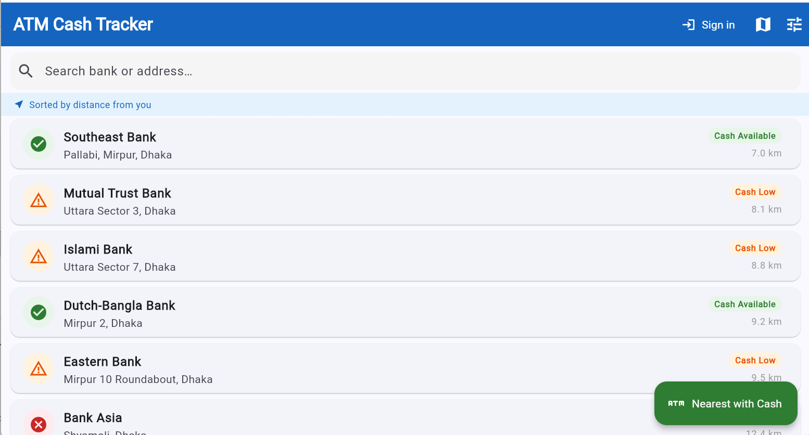
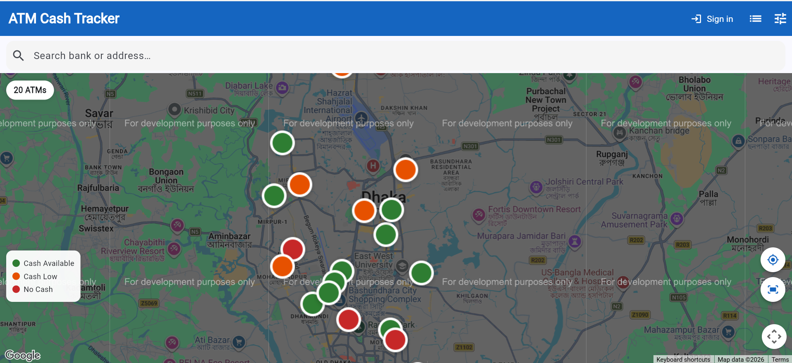
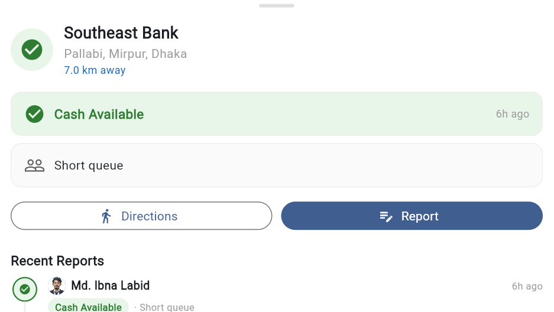
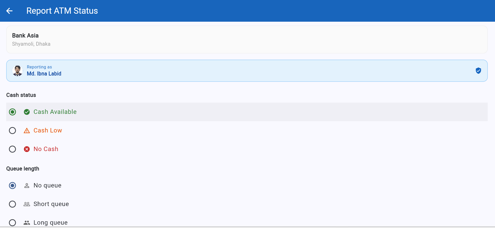

<div align="center">

# 🏧 ATM Cash Tracker

### Real-time ATM cash availability across Dhaka, Bangladesh

[](https://flutter.dev)
[](https://dart.dev)
[](https://firebase.google.com)
[](https://developers.google.com/maps)
[]()
[](LICENSE)

</div>

---

## 📖 Overview

Finding a working ATM with cash in Dhaka is a daily frustration — machines run
dry, queues stretch around the block, and there's no way to know until you're
already standing there.

**ATM Cash Tracker** is a crowdsourced, real-time map of ATM booths across Dhaka.
Users report cash status and queue length from the field, and every other user
sees that update **instantly** via a Firestore stream listener. Reports are tied
to verified Google accounts so the data stays trustworthy, and rate limiting
prevents spam.

Built with Flutter for **web and Android** from a single codebase.

---

## 📸 Screenshots

<div align="center">

| List View | Map View |
|:---:|:---:|
|  |  |

| ATM Detail & Report History | Report Submission |
|:---:|:---:|
|  |  |

</div>

---

## ✨ Features

### 💵 Real-Time Cash Status
Live Firestore stream listener — when any user reports a status change, every
open client updates instantly with no refresh. Three states, colour-coded
throughout the UI and on map markers:

| Status | Colour | Meaning |
|:---|:---:|:---|
| 🟢 **Cash Available** | Green | Machine is dispensing normally |
| 🟠 **Cash Low** | Orange | Running low, may run out soon |
| 🔴 **No Cash** | Red | Empty or out of service |

### 🚶 Queue Tracking
Reporters log how long the line is — **No queue**, **Short queue**, or
**Long queue** — so you can weigh a nearby-but-crowded ATM against a slightly
further empty one.

### 📍 Distance Calculation & Proximity Sorting
Live GPS via `geolocator` (browser permission prompt on web). Distances are
computed with the **Haversine formula** and the list auto-sorts nearest-first
with a "Sorted by distance from you" indicator. A custom blue user-position
marker is drawn at runtime using `dart:ui` Canvas.

### 🎯 Nearest With Cash
One tap on the green FAB finds the closest ATM with confirmed cash, switches to
map view, flies the camera to it, and opens its detail sheet — with the walking
distance shown in a snackbar.

### 🔐 Google Authentication
Firebase Auth with Google Sign-In. Reports are tied to real, verified identities
rather than anonymous writes — the reporter's name and avatar appear on every
entry so users can judge credibility.

### 🕒 Report History with Relative Timestamps
Every ATM's detail sheet shows a vertical timeline of recent reports:

```
● Raiyan reported Cash Available          5m ago
│ · No queue
│
● Labid reported Cash Low                 2h ago
│ · Long queue — only one machine working
│
● Mahi reported No Cash                   Aug 24
```

Timestamps render as human-readable relative times (`just now`, `12m ago`,
`3h ago`, then falling back to a date).

### 🛡️ Spam Prevention
Rate limited to **one report per user, per ATM, per hour**. The check runs
server-side against Firestore before the write is committed, and the UI shows
the exact remaining cooldown if a user tries again too soon.

### 🗺️ Interactive Map
Google Maps with colour-coded markers rendered from `dart:ui` Canvas, a status
legend overlay, live ATM count badge, "center on me" and "fit all markers"
controls, and one-tap **walking directions** that launch Google Maps externally.

### 🔍 Search & Filtering
Full-text search across bank names and addresses, plus dual-axis filter chips
(by cash status **and** by bank) with an advanced filter bottom sheet.

### 🌗 Dark / Light Theme
Material 3 theming with a seamless in-app toggle. Every surface, card, input,
and overlay adapts through M3 colour roles — no hardcoded colours left behind.

---

## 🛠 Tech Stack

| Layer | Technology |
|:---|:---|
| **Framework** | Flutter 3.x (Web + Android from one codebase) |
| **Language** | Dart 3.x |
| **Database** | Cloud Firestore (region: `asia-south1` / Mumbai) |
| **Authentication** | Firebase Auth + Google Sign-In |
| **Maps** | `google_maps_flutter` |
| **Location** | `geolocator` |
| **External Links** | `url_launcher` |
| **Date Formatting** | `intl` |
| **Design System** | Material 3 |

### Key Dependencies

```yaml
dependencies:
  flutter:
    sdk: flutter
  firebase_core: ^2.24.0
  cloud_firestore: ^4.13.0
  firebase_auth: ^4.15.0
  google_sign_in: ^6.1.6
  google_maps_flutter: ^2.5.0
  geolocator: ^10.1.0
  url_launcher: ^6.2.1
  intl: ^0.18.1
```

---

## 🏗 Architecture

```
lib/
├── main.dart              # Single-file application
└── firebase_options.dart  # Generated by FlutterFire CLI
```

**Data model** — `AtmInfo` documents in the `atm_booths` collection, each with a
`reports/` subcollection:

```
atm_booths/{atmId}
├── bankName, address, latitude, longitude
├── status         (available | low | empty)
├── queueLength    (noLine | shortLine | longLine)
├── notes, lastUpdated, fallbackDistance
└── reports/{reportId}
    ├── userId, displayName, photoUrl
    ├── status, queueLength, notes
    └── timestamp
```

**Services** — two singletons: `FirestoreService` (stream listeners, batched
writes, spam checks) and `AuthService` (platform-aware Google sign-in — popup on
web, native flow on Android).

---

## 🚀 How to Run Locally

### Prerequisites

- Flutter SDK 3.x → [install guide](https://docs.flutter.dev/get-started/install)
- A Firebase project with **Firestore** and **Authentication** enabled
- A Google Maps API key

### 1. Clone the repository

```bash
git clone https://github.com/mdibnalabid/atm-cash-tracker.git
cd atm-cash-tracker
```

### 2. Install dependencies

```bash
flutter pub get
```

### 3. Configure Firebase

Install the FlutterFire CLI and generate your own `firebase_options.dart`:

```bash
dart pub global activate flutterfire_cli
flutterfire configure
```

Then in the **Firebase Console**:

- **Authentication → Sign-in method** → enable **Google**, set a support email
- **Authentication → Settings → Authorized domains** → add `localhost`
- **Firestore Database** → create the database in your preferred region
- Seed an `atm_booths` collection (see the data model above)

### 4. Add your Google Maps API key

**Web** — in `web/index.html`, inside `<head>`:

```html
<script src="https://maps.googleapis.com/maps/api/js?key=YOUR_API_KEY"></script>
```

**Android** — in `android/app/src/main/AndroidManifest.xml`, inside
`<application>`:

```xml
<meta-data
    android:name="com.google.android.geo.API_KEY"
    android:value="YOUR_API_KEY"/>
```

### 5. Run

```bash
# Web
flutter run -d chrome

# Android
flutter run -d android
```

---

## 🔒 Firestore Security Rules

The development rules below are **open** and must be tightened before any real
deployment:

```javascript
rules_version = '2';
service cloud.firestore {
  match /databases/{database}/documents {
    match /atm_booths/{atmId} {
      // Anyone can read ATM data
      allow read: if true;
      // Only signed-in users can update status
      allow update: if request.auth != null;
      allow create, delete: if false;

      match /reports/{reportId} {
        allow read: if true;
        // Users may only create reports under their own uid
        allow create: if request.auth != null
                      && request.resource.data.userId == request.auth.uid;
        allow update, delete: if false;
      }
    }
  }
}
```

---

## 🗺 Roadmap

- [ ] Push notifications when a nearby ATM is restocked
- [ ] Offline caching with local persistence
- [ ] Bengali (বাংলা) localisation
- [ ] Report reliability scoring per user
- [ ] Expand coverage beyond Dhaka
- [ ] Bank-provided official status integration

---

## 🤝 Contributing

Contributions are welcome. Fork the repo, create a feature branch, and open a
pull request.

```bash
git checkout -b feature/your-feature
git commit -m "feat: add your feature"
git push origin feature/your-feature
```

---

## 📄 License

Distributed under the MIT License. See [`LICENSE`](LICENSE) for details.

---

## 👤 Author

**Md. Ibna Labid**
Final-year Computer Science & Engineering student
Daffodil International University, Dhaka, Bangladesh

[](https://github.com/mdibnalabid)
[](https://www.linkedin.com/in/mdibnalabid/)

---

<div align="center">

**⭐ If you find this project useful, consider giving it a star!**

Built with 💙 in Dhaka

</div>
